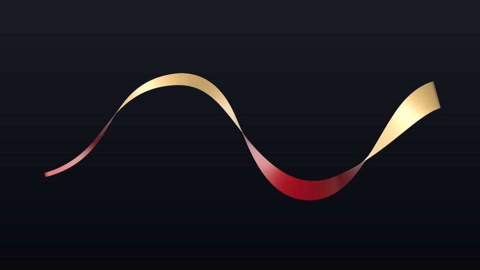
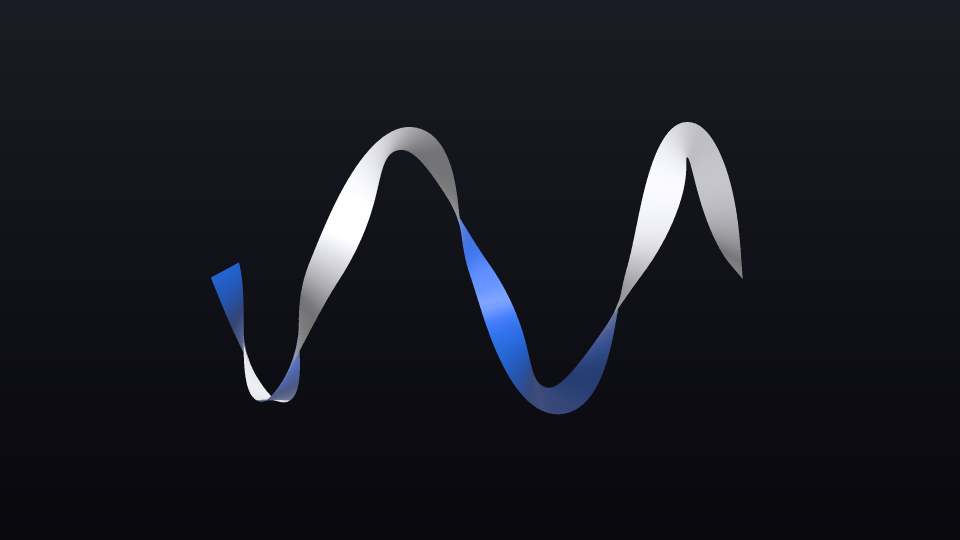
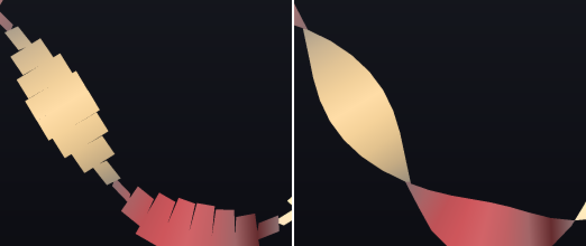

# Ribbon 3D — реалистичные 3D-ленты по пути для After Effects

ScriptUI-панель, которая строит живой 3D-риг ленты вдоль пути: закрутка, сужение,
волны, двусторонний цвет, гладкое затенение с сатиновыми бликами или текстура
(композиция / футаж) на ленте. Камера, свет, DOF, motion blur и 3D-рендереры AE
работают как с обычными 3D-слоями.




*(превью отрисованы тестовым растеризатором из `tests/`, не самим AE)*

> Нужна скорость и попиксельное освещение? Есть нативная версия-эффект с рендером на GPU
> (CUDA / OpenCL / Metal): [`../Ribbon3DGPU`](../Ribbon3DGPU/README.md).

## Установка

1. Скопируйте `Ribbon3D.jsx` в `…/Adobe After Effects <версия>/Scripts/ScriptUI Panels/`.
2. Перезапустите AE и откройте **Window → Ribbon3D.jsx** (панель докается).
   Можно и без установки: **File → Scripts → Run Script File…** — откроется плавающее окно.
3. Рекомендуется движок выражений **JavaScript** (Project Settings → Expressions).
   Legacy ExtendScript тоже поддерживается, но заметно медленнее.

Требуется AE CC 2018 (15.1) или новее — нужны `createPath()` и `points()` в выражениях.

## Быстрый старт

**Лента по нарисованному пути**
1. Нарисуйте путь Pen-тулом (шейп-слой) или маску на любом слое. Слой можно сделать 3D и повернуть.
2. Выделите путь (или просто слой с ним) → **Create Ribbon**.

**Лента через 3D-нули (полностью трёхмерная траектория)**
1. Выделите 2+ слоя (обычно 3D-нули) → **Create Ribbon**. Порядок точек — в поле *Point order*
   (по умолчанию сверху вниз по таймлайну).
2. Лента проходит через нули по гладкому сплайну и следует за ними при анимации.

**Путь → 3D-нули**
Выделите путь → **Path -> 3D Nulls**: по вершинам пути создаются 3D-нули (верхний = первая вершина)
и сразу выделяются. Двигайте их по Z и жмите **Create Ribbon**.

Создаются: контроллер `Ribbon 3D N` (нуль со всеми параметрами), нуль-источник света
`Ribbon 3D N Light` и сегменты `Ribbon 3D N [001…]` (shy + locked, чтобы не мешали в таймлайне).

## Параметры панели

| Поле | Что делает |
|---|---|
| Segments | Число сегментов. 60–150 обычно достаточно; больше — глаже затенение, медленнее рендер |
| Width | Стартовая ширина ленты, px (потом меняется на контроллере) |
| Type | **Color** — шейп-слои с цветом/затенением; **Texture** — каждый сегмент показывает свой кусок выбранной композиции/футажа |
| Shading | **Built-in smooth** — собственное гладкое затенение (свет AE на ленту не действует); **AE lights** — плоский цвет, освещают источники света AE |
| Point order | Порядок слоёв-точек для режима «через нули» |
| Closed loop | Замкнуть сплайн через нули |
| Hide segments | Сделать сегменты shy и включить скрытие shy-слоёв |
| Rebuild | Пересобрать выделенную ленту с новым числом сегментов (выделите контроллер или любой сегмент) |
| Sync Materials | После переключения *Built-in Shading* на контроллере — выставить сегментам Accepts Lights |
| Delete | Удалить ленту целиком (сегменты, контроллер, нуль света) |

## Контроллер

| Эффект | Описание |
|---|---|
| Start / End / Offset | Обрезка вдоль пути в % длины (как Trim Paths). Анимируйте End для «прорастания» |
| Width, Width Start / Width End | Ширина и сужение к концам (% от Width) |
| Twist | Число оборотов закрутки |
| Twist Angle | Начальный поворот ленты вокруг пути (0 — лента лежит в плоскости пути, 90 — стоит «ребром») |
| Twist Speed | Автоматическое вращение закрутки, °/с |
| Twist Along Path | Вкл — узор закрутки привязан к пути (при росте ленты не «плывёт»); выкл — к самой ленте |
| Wave Amp / Wave Length / Wave Speed | Волна, смещающая ленту из плоскости пути (px, px, px/с) — даёт объём плоскому пути и «полёт» |
| Spline Smooth | Плавность сплайна через нули (0.33 ≈ Catmull-Rom) |
| Overlap | Нахлёст сегментов, px — прячет швы сглаживания |
| Camera Fit | Подгонка углов сегментов к лучам камеры: стыки без «ступенек» даже при сильной закрутке (см. ниже) |
| Front Color / Back Color | Цвет лицевой и обратной стороны |
| Built-in Shading | Собственное освещение (см. ниже) |
| Light | Слой-источник для встроенного освещения: нуль или свет AE (у света берутся цвет и интенсивность) |
| Ambient / Diffuse / Specular / Gloss | Фоновое, рассеянное, бликовое освещение и узость блика |
| Satin | 0 — обычный глянец, 1 — анизотропный «сатиновый» блик вдоль волокон ленты |
| Rim | Подсветка по краям, где лента уходит «ребром» к камере |
| Opacity | Прозрачность ленты |
| Flip Gradient | Если затенение получилось «полосатым» (зубчатым) — включите (см. «Ограничения») |

## Как это устроено

Лента — цепочка тонких 3D-слоёв. На каждом сегменте есть маска `RB Data` (режим None),
в выражении которой лежит вся математика:

1. путь (Безье шейпа/маски с учётом трансформаций групп и слоя, либо сплайн через нули)
   переводится в мировые координаты;
2. строится таблица длины дуги и **rotation-minimizing frame** (метод двойного отражения) —
   лента не перекручивается сама по себе на изгибах 3D-траектории;
3. применяются обрезка, волна, закрутка, сужение; считаются 4 угла сегмента,
   его плоскость и ориентация (Orientation в конвенции AE `Rx·Ry·Rz`);
4. считается цвет в начале и конце сегмента: Blinn-Phong + анизотропный блик Kajiya-Kay + rim,
   в линейном пространстве, двусторонне (лицо/изнанка — по положению камеры);
5. всё упаковывается в вершины пути маски.

Остальные свойства сегмента (Position, Orientation, Opacity, путь шейпа, точки градиента,
цвета Tint) — короткие выражения, читающие эти данные. Цвет внутри сегмента интерполируется
связкой *Gradient Fill (белый→чёрный) + Tint*, поэтому затенение гладкое (Гуро), а не ступенчатое.

**Camera Fit.** Закрученный участок ленты не плоский, а слой — плоский. Если просто
проецировать углы на плоскость сегмента, на силуэте появляются ступеньки. Риг сдвигает
каждый угол вдоль луча камеры до плоскости сегмента: в кадре соседние сегменты стыкуются
точно, а сдвиг по глубине — доли пикселя. Для сегментов, видимых почти ребром, плоскость
дополнительно наклоняется на несколько градусов. Слева — без подгонки, справа — с ней
(50 сегментов, 3 оборота):



Подгонка считается для активной камеры композиции. При просмотре через другие виды
(Custom View, Top и т. п.) ступеньки видны — это нормально.

## Текстурный режим

- Выберите композицию или футаж в списке *Texture* (кнопка *Refresh* обновляет список).
- Ширина текстуры ложится **вдоль** ленты (от Start до End), высота — **поперёк** (на базовую Width).
  Удобно сделать композицию-текстуру с пропорцией «длина ленты : ширина», например 4000×200.
- Сегменты освещаются светом AE (Accepts Lights включено), встроенное затенение здесь не используется.
- Сужение обрезает текстуру, а не сжимает её.

## Советы

- Начните с 80–120 сегментов. Для финального рендера с крупным планом — 200+.
- Реализм: включите Motion Blur и Depth of Field камеры; в режиме AE lights добавьте свет
  с тенями — сегменты отбрасывают тени (Casts Shadows включено).
- Плоский путь + `Wave Amp` уже даёт объёмную ленту; для сложной траектории используйте нули.
- Классический приём: анимируйте `End` 0→100 и `Twist Speed` — лента «вылетает» и крутится.
- Можно переименовывать слой пути и контроллер — AE сам обновит ссылки в выражениях,
  а *Rebuild* берёт актуальный источник из существующих сегментов.

## Ограничения

- **Производительность.** Каждый сегмент считает траекторию сам; 100 сегментов — сотни
  выражений. Для анимации предпросмотра уменьшайте число сегментов или разрешение.
- **Flip Gradient.** Затенение опирается на то, что градиент по умолчанию у Gradient Fill —
  белый→чёрный. Если в вашей версии AE иначе, цвет на стыках будет «зубчатым» — включите Flip Gradient.
- **Замкнутые пути.** У rotation-minimizing frame на замкнутом контуре может быть небольшой
  излом закрутки в точке замыкания; компенсируйте `Twist Angle`/`Twist`.
- Параметрические фигуры (Rectangle/Ellipse/Star) нужно сначала конвертировать в Bezier Path.
- Сегменты рассчитаны на слой без родителя; не парентите их и не меняйте их трансформации вручную.

## Разработка

Код выражения-ядра — в `src/core.expr.js` (ES3, чтобы работал и в Legacy-движке).
Он встраивается в `Ribbon3D.jsx` скриптом сборки:

```bash
node Ribbon3D/tools/build.js          # встроить ядро в Ribbon3D.jsx
node Ribbon3D/tools/build.js --check  # проверить, что jsx актуален
node --test Ribbon3D/tests/test.js    # тесты (Node 18+)
node Ribbon3D/tests/preview.js        # превью-картинки в Ribbon3D/tests/out/
```

Тесты выполняют **те же строки выражений**, что скрипт ставит в AE, в моке окружения
выражений (thisComp, слои, toWorld, маски, эффекты, createPath) и восстанавливают мировую
геометрию по модели трансформаций AE. Проверяются: попадание центральной линии на путь,
обрезка по длине дуги, точность закрутки/ширины/сужения в экранном пространстве, стыковка
сегментов, текстурные координаты, выбор лицевой/обратной стороны, непрерывность затенения,
источники «маска на 2D-слое» и «сплайн через нули», замкнутые пути.
Синтаксис ES3 проверяется, если указать путь к `acorn`:
`ACORN=/path/to/node_modules/acorn node --test Ribbon3D/tests/test.js`.

Сам ScriptUI/DOM-код AE (создание слоёв, эффектов, масок) этими тестами не покрыт —
его нужно проверять в After Effects.
