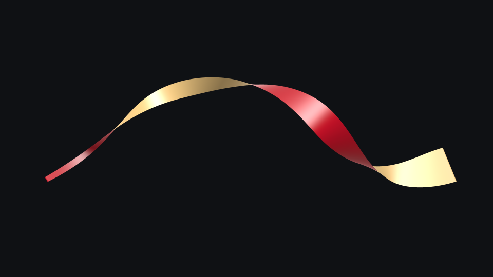
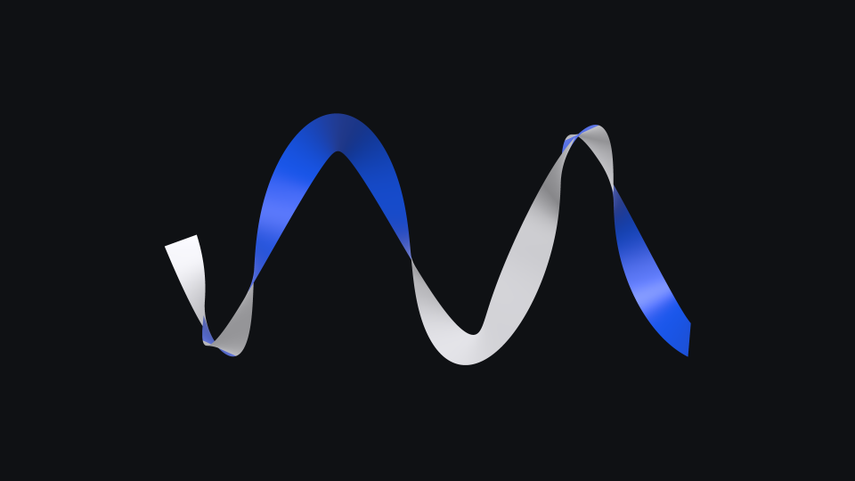

# Ribbon 3D GPU — нативный эффект After Effects с рендером на видеокарте

Эффект рисует реалистичную 3D-ленту вдоль маски: закрутка, сужение, волны, двусторонний
цвет, попиксельное освещение с сатиновым бликом, блеском по краям и просвечиванием,
текстура со слоя, свет и камера композиции. Растеризация и освещение считаются на GPU
(CUDA, OpenCL, Metal), без поддерживаемой видеокарты — на CPU в несколько потоков
**тем же самым кодом кернела**.





*(кадры отрисованы тестами из `tests/` — CPU-путём и OpenCL-кернелом; не скриншоты AE)*

Скриптовая версия без компиляции лежит рядом: [`../Ribbon3D`](../Ribbon3D/README.md).

## Чем отличается от скрипта

| | Скрипт `Ribbon3D.jsx` | Эффект `Ribbon 3D GPU` |
|---|---|---|
| Геометрия | цепочка 3D-слоёв, 50–200 сегментов | один эффект, до 4000 сегментов (настоящая сетка треугольников) |
| Затенение | по сегментам (Гуро через градиент) | попиксельное (Phong + анизотропный сатин + Френель + просвечивание) |
| Сглаживание | средствами AE | суперсэмплинг до 16× |
| Скорость | сотни выражений на кадр | геометрия на CPU < 1 мс, пиксели на GPU |
| Установка | скопировать .jsx | собрать с AE SDK (C++) |

## Статус — что проверено, а что нет

- **Ядро** (геометрия, проекция, отсечение, тайлы) и **кернел** покрыты тестами.
- **OpenCL-кернел** выполнен на OpenCL-устройстве (pocl на CPU) и совпадает с CPU-путём до 1e-4.
- **CUDA-кернел** встроен в плагин как PTX (собран clang, `tools/build_ptx.sh`) и загружается драйвером
  NVIDIA через driver API — CUDA Toolkit не нужен ни для сборки, ни для работы. Встроенный PTX
  собирается настоящим `ptxas` (CUDA 12.9) для sm_52…sm_89 без ошибок; на реальной видеокарте не запускался.
- **Metal-ветка** проверена только синтаксически — компилятора Metal не было.
- **Обвязка AE** (параметры, SmartFX, GPU-сетап, маска, камера, свет) собрана и прогнана
  через имитатор хоста AE (`tests/host_sim`): CPU 8/32 бит и GPU-путь через OpenCL.
- **Сборка с настоящим AE SDK 27.0.0 (Windows)** проходит без ошибок и предупреждений
  (`tools/build_win_mingw.sh`, MinGW-w64). Ресурс PiPL сверен с форматом самого `PiPLtool.exe` и
  шаблоном `AE_General.r`; раскладка ключевых структур SDK (размеры, выравнивания, смещения
  полей) совпадает с правилами MSVC. Плагин запущен и работает в After Effects на Windows (проверено
  пользователем); видеокарта и путь рендера (CUDA / OpenCL / CPU) на его машине отдельно не замерялись.
- **Версии**: до первого выпуска — 0.1.xx (сейчас 0.1.10, видна в About эффекта); 1.0 — первый выпуск.

## Сборка

Нужны: [After Effects SDK](https://developer.adobe.com/after-effects/) (лучше 2022 или новее),
CMake 3.20+, на Windows — Visual Studio 2022, на macOS — Xcode. CUDA Toolkit и OpenCL SDK **не нужны**:
OpenCL (`OpenCL.dll`) и CUDA (`nvcuda.dll`) подгружаются при запуске, если они есть в системе,
поэтому плагин загружается на любой машине, а без подходящей видеокарты просто считает на CPU.

`AE_SDK_DIR` — папка `Examples` из SDK (в ней `Headers`, `Util`, `Resources`).

**Windows**
```bat
cmake -S Ribbon3DGPU -B build -G "Visual Studio 17 2022" -A x64 -DAE_SDK_DIR="C:/AfterEffectsSDK/Examples"
cmake --build build --config Release --target Ribbon3DGPU
```
Скопируйте `build\Release\Ribbon3DGPU.aex` в `C:\Program Files\Adobe\Common\Plug-ins\7.0\MediaCore\`
(или в `Plug-ins` папки After Effects).

**macOS**
```bash
cmake -S Ribbon3DGPU -B build -G Xcode -DAE_SDK_DIR=$HOME/AfterEffectsSDK/Examples \
      -DCMAKE_OSX_ARCHITECTURES="arm64;x86_64"
cmake --build build --config Release --target Ribbon3DGPU
codesign --force --deep -s - build/Release/Ribbon3DGPU.plugin
```
Скопируйте `Ribbon3DGPU.plugin` в `/Library/Application Support/Adobe/Common/Plug-ins/7.0/MediaCore/`.

Что делает сборка:
- `cmake/EmbedKernel.cmake` встраивает исходник кернела в заголовок — OpenCL и Metal компилируют его
  при запуске AE, CUDA-кернел встроен готовым PTX (`src/kernel/RibbonKernelPTX.h`, пересобирается
  `tools/build_ptx.sh` после правок кернела);
- `tools/PiPLValuesGen.cpp` вычисляет флаги PiPL из enum'ов самого SDK, так что PiPL и код
  не могут разойтись (частая причина ошибки «plug-in flags mismatch»);
- PiPL собирается штатно: на Windows через `PiPLtool.exe` из SDK, на macOS через `Rez`.

Бэкенды: Windows — CUDA и OpenCL, macOS — Metal и OpenCL.

**Кросс-сборка Windows-плагина из Linux** (MinGW-w64, без Visual Studio и без запуска Windows-программ):
```bash
sudo apt install g++-mingw-w64-x86-64-posix binutils-mingw-w64-x86-64 cmake python3
Ribbon3DGPU/tools/build_win_mingw.sh /path/to/AfterEffectsSDK/Examples build-win
pip install pefile && python3 Ribbon3DGPU/tools/check_aex.py build-win/Ribbon3DGPU.aex
```
Здесь PiPL собирается без `PiPLtool.exe`: `tools/make_pipl.py` пишет двоичный ресурс по формату PiPL,
а числа флагов берутся из объектного файла, скомпилированного с заголовками SDK (`tools/pipl_values.cpp`).
`check_aex.py` проверяет экспорт (`EffectMain`, `PluginDataEntryFunction2`), что плагин зависит только
от системных DLL, и расшифровывает ресурс PiPL.

## Как пользоваться

1. Создайте солид **размером с композицию** и оставьте его **2D без трансформаций**
   (эффект рисует в пространстве композиции через её камеру).
2. Нарисуйте на солиде маску (путь ленты) и поставьте ей режим **None**, чтобы она не обрезала слой.
3. **Effect → Generate → Ribbon 3D GPU**, в поле **Path** выберите маску.
4. По умолчанию рисуется только лента на прозрачном фоне (**Render → Composite → Ribbon Only**);
   чтобы лента легла поверх содержимого слоя — **Over Layer**, под ним — **Behind Layer**.
5. GPU: **File → Project Settings → Video Rendering and Effects → Mercury GPU Acceleration**
   (CUDA / OpenCL / Metal). При других вариантах (в т. ч. DirectX) эффект считается на CPU.

Камера композиции, её движение и зум учитываются автоматически; источники света
композиции — если включено **Use Comp Lights** (точечный, направленный, прожектор, ambient).
Без камеры используется вид AE по умолчанию (50 мм).

## Управление нулями (0.1.02)

Кнопка **Control Nulls → Create Nulls from Mask** создаёт по 3D-нулю на каждую вершину маски
(«Ribbon Pt 01», «Ribbon Pt 02»…, одним шагом отмены), подставляет их в слоты **Points** и
переключает **Path Source** на **Control Nulls**. Дальше лента идёт по нулям:

- **Position** — точка ленты (нули можно двигать по Z, анимировать, парентить);
- **Rotation / Orientation** — ось X нуля задаёт направление касательной, а поворот вокруг этой оси
  крутит ленту: ширина ленты лежит вдоль оси Y нуля, лицевая сторона смотрит против его оси Z.
  Между нулями крен меняется плавно; закрутка (Twist) добавляется сверху;
- **Scale X** — длина касательных: 100 % — плавная кривая (треть расстояния до соседа),
  0 % — острый угол, 200 % — сильнее изгиб. Y и Z масштаба не используются.

Лента обновляется сразу при перемещении, повороте или масштабировании нуля (в том числе через
родителей и выражения): эффект подмешивает трансформации нулей в ключ кэша AE
(`PF_OutFlag2_I_MIX_GUID_DEPENDENCIES`), поэтому неизменённые кадры по-прежнему берутся из кэша.
С этим флагом AE требует вызова `GuidMixInPtr` в каждом PreRender, в любом режиме — иначе выдаёт
«internal verification failure».

Нули можно добавлять и вручную: выберите любые слои в слотах Point 1…32 (порядок слотов = порядок
точек). Вершины маски сверх 32 не превращаются в нули — об этом выводится сообщение.

## Параметры

| Параметр | Описание |
|---|---|
| Path | Маска на этом слое — путь ленты |
| Segments | Сегментов вдоль ленты (2–4000). 300–600 хватает почти всегда |
| Start / End / Offset | Обрезка вдоль пути, % длины (как Trim Paths) |
| Width, Width Start / End | Ширина, px, и сужение к концам, % |
| Twist (turns), Twist Angle | Число оборотов закрутки и начальный поворот (0° — лента в плоскости маски) |
| Twist Speed | Автовращение закрутки, °/с |
| Twist Along Path | Узор закрутки привязан к пути (при росте ленты не «плывёт») |
| Wave Amplitude / Length / Speed | Волна из плоскости маски — объём и «полёт» |
| **Path Transform** | Поворот X/Y/Z, смещение X/Y/Z и масштаб пути в 3D (центр — центр маски) |
| **Material** | Цвета лица/изнанки; Texture Layer (u — вдоль ленты, v — поперёк, альфа текстуры = прозрачность ленты), Repeat/Offset; Ambient, Diffuse, Specular, Glossiness; Satin (0 — глянец, 1 — анизотропный блик вдоль волокон); Sheen (блеск по Френелю на скользящих углах); Translucency (свет сзади просвечивает тонкую ленту); Metal (блик окрашивается цветом ленты) |
| **Lighting** | Use Comp Lights; встроенный свет (Azimuth, Elevation, Intensity, Color), если в композиции нет источников |
| **Render** | Antialiasing 1/4/9/16 сэмплов (в Draft-превью всегда 1); Composite: поверх слоя / за слоем / только лента (по умолчанию — только лента, вокруг прозрачно); Opacity; Linear Working Space — для проектов с линейным рабочим пространством |
| **Thickness & Bevel** (0.1.01) | Thickness — толщина ленты, px (0 — тонкий двусторонний лист, как в 0.1.00); Bevel Size — радиус скругления или размер среза рёбер; Bevel Style — Round / Chamfer (срез 45°); Bevel Smoothness — сегментов на скругление (в Draft-превью не больше 2); Edge Color — цвет рёбер: как лицо / как изнанка / свой (Custom Edge Color); End Caps — закрыть торцы |
| **Control Nulls** (0.1.02) | Path Source — Mask или Control Nulls; кнопка **Create Nulls from Mask**; Closed Loop — замкнуть сплайн через нули; Points → Point 1…32 — слои-точки по порядку (пустые пропускаются) |
| Cycle (0.1.04) | Когда Start/End + Offset выходят за 0…100 %, лента продолжается с другого конца пути — и на открытом пути тоже. Выключено — часть за концом пути просто скрыта |
| Orientation (0.1.05) | **Twist** — как раньше: лента идёт по пути и закручивается параметрами Twist. **Front** — маска считается видом сверху: лента лежит плашмя в горизонтальной плоскости лицевой стороной вниз, Twist не действует |
| **Gradient** (0.1.10) | Gradient — Off / Along Path / Random per Path (последнее — только Multi-Mask); Gradient Colors — 2, 3 или 4 цвета; Color 1…4; Gradient Repeat и Gradient Offset — для Along Path; Gradient Seed — для Random per Path |
| **Roughness Map** (0.1.09) | Roughness Layer — ч/б карта шероховатости (белое — матовое, чёрное — гладкое); Roughness Amount — насколько карта заменяет Glossiness; Invert — для gloss-карт (белое — гладкое). Укладка — как у Normal Map |
| **Frosted Glass** (0.1.09) | Frost (px) — размытие того, что видно сквозь стекло (матовое стекло); с Roughness Map — по карте: белое матовое, чёрное прозрачное; Frost Samples — качество размытия |
| **Ends** (0.1.09) | End Rounding — скругление концов ленты (0 — прямой срез, 100 % — полукруг); Round Ends — оба конца / только начало / только конец |
| **Normal Map** (0.1.08) | Normal Map Layer — слой с картой нормалей (tangent space); Normal Strength — сила рельефа; Normal Mapping — Tiles (квадратные плитки Tile Size px) или Like Texture (как текстура: Texture Repeat / Offset); Green Channel — OpenGL (Y+) или DirectX (Y−) |
| **Wind** (0.1.07) | Wind Strength (0 — выключен); Wind Direction (0° — вверх, 90° — вправо); Pinned End — какой конец закреплён (Start / End); Flutter (px), Flutter Speed (Hz), Flutter Wavelength — волны от точки крепления к свободному концу; Twist Flutter — закручивание на ветру, °; Gusts — порывы; Stiffness — насколько неподвижна часть у крепления; Random Seed — другой рисунок порывов |
| **Environment** (0.1.06) | HDRI Layer — слой с HDRI-картой (равнопромежуточная проекция 2:1); Env Intensity — сила света от карты; Env Rotation — поворот карты вокруг вертикали; Reflections — сила отражений |
| **Glass** (0.1.06) | Glass — включить стекло; IOR — коэффициент преломления (1.5 — стекло); Transmission — сколько света проходит насквозь; Tint — насколько цвет ленты окрашивает стекло; Refraction (px) — сила смещения фона при преломлении |
| Fit Layer + **Configure** (0.1.04) | Выберите слой (композиция, изображение, видео; текст/шейп — по размеру композиции), нажмите Configure: слой становится текстурой, Width выставляется так, чтобы слой лёг на видимую ленту без растяжения |

## Два эффекта: Ribbon 3D GPU и Ribbon 3D GPU Multi-Mask (0.1.10)

Сборка даёт два плагина — два файла, два эффекта в **Effect → Generate**:

- **Ribbon 3D GPU** (`Ribbon3DGPU.aex`) — как раньше: лента по маске из **Path** или по нулям.
- **Ribbon 3D GPU Multi-Mask** (`Ribbon3DGPU_MultiMask.aex`) — лента **по каждой маске слоя**.
  Все параметры те же (рендер общий), скрыты только Path и группа Control Nulls. Start / End / Offset
  и Cycle действуют на все маски сразу и независимо — как Trim Paths в режиме **Simultaneously**:
  короткая и длинная маски одновременно вырастают от 0 до 100 %. Маски — один рисунок: Path Transform
  и Front поворачивают их вокруг общего центра. У каждой маски свои порывы ветра. Configure
  подгоняет ширину под самую длинную маску. Все маски — в режиме None, чтобы не обрезали слой.

Положите в папку плагинов оба файла (или только нужный).

**Gradient** (в обоих эффектах) — вместо Front / Back Color:

- **Along Path** — градиент вдоль ленты от Color 1 к последнему цвету. **Gradient Repeat** — сколько раз
  он укладывается по длине, **Gradient Offset** — сдвиг. За концами градиент идёт обратно (отражается),
  поэтому анимация Offset даёт плавно «текущие» цвета без скачка.
- **Random per Path** (только Multi-Mask) — каждая маска получает свой случайный цвет из градиента
  (плавно между ключевыми цветами); **Gradient Seed** — другой набор цветов.
- Цвета смешиваются как в градиентах AE (в рабочем пространстве), текстура ложится поверх, как
  раньше; рёбра толстой ленты следуют градиенту, если Edge Color не Custom; стекло окрашивается
  градиентом через Tint.

Плитки Normal / Roughness Map (Tiles) теперь отсчитываются по длине каждой ленты, поэтому на лентах
разной длины они одинаковые и квадратные.

## Roughness Map, матовое стекло, скруглённые концы (0.1.09)

**Roughness Map.** Чёрно-белая карта шероховатости в **Roughness Map → Roughness Layer** (импорт,
в композицию, глаз выключить). Белое — шероховатое: блик широкий и тусклый, отражения HDRI
размыты. Чёрное — гладкое: блик узкий и яркий, отражения чёткие. **Roughness Amount** — насколько
карта заменяет Glossiness (0 — карта не действует). **Invert** — если карта «глянцевая» (gloss map:
белое — гладкое). Укладка на ленту — общая с Normal Map (Tiles / Like Texture и Tile Size), как у
обычных PBR-наборов. Как и карта нормалей, это данные: в линейном проекте — Preserve RGB.

**Frosted Glass.** **Frost (px)** размывает то, что видно сквозь стекло, — матовое стекло. Работает
там же, где преломление: **Composite → Over Layer** (например, эффект на Adjustment Layer); в режиме
Ribbon Only эффект не видит нижние слои. Вместе с Roughness Map размытие идёт по карте: белое —
матовое, чёрное — прозрачное (матовые узоры, надписи на прозрачном стекле). Отражения на матовых
местах тоже размываются. **Frost Samples** — качество (в Draft-превью всегда Low).

**Скруглённые концы.** **Ends → End Rounding**: 0 — прямой срез, 100 % — полукруг, между ними —
скруглённые углы. **Round Ends** — оба конца, только начало или только конец. Скругление считается
настоящей геометрией (у концов добавляются сечения), текстура обрезается формой, а не сжимается;
толстая лента скругляется в плане. Скругляются концы самой ленты (Start / End), а не места, где
Cycle переносит её через конец пути.

## Normal Map (0.1.08)

Карта нормалей добавляет ленте рельеф — плетение ткани, тиснение, «кованый» металл, рябь на стекле —
без лишней геометрии. Импортируйте карту (обычная синеватая tangent-space normal map), положите в
композицию, выключите глаз и выберите в **Normal Map → Normal Map Layer**. Рельеф учитывают свет,
блики, Satin, отражения HDRI и преломление стекла.

- **Normal Mapping → Tiles** (по умолчанию): карта укладывается квадратными плитками размера
  **Tile Size (px)** — вдоль ленты столько плиток, сколько помещается в её видимую длину, поэтому
  рельеф не растягивается на длинной ленте. **Like Texture**: карта растянута по ленте, как
  текстура (Texture Repeat / Offset) — для карт, сделанных из самой текстуры.
- **Green Channel**: OpenGL (Y+, Blender, Substance по умолчанию) или DirectX (Y−, Unreal, многие
  наборы для игр). Если рельеф выглядит «вдавленным» вместо выпуклого — переключите.
- Тонкая лента: на изнанке рельеф обратный, как у тиснёной ткани. Толстая: рельеф на лицевой и
  изнаночной гранях, к рёбрам плавно сходит на нет.
- Карта нормалей — это данные, не цвет: в проекте с линейным рабочим пространством поставьте ей
  **Interpret Footage → Preserve RGB**, иначе AE исказит значения.

## Ветер (0.1.07)

**Wind → Wind Strength** больше нуля включает ветер. Один конец пути (**Pinned End**: начало или
конец маски / первый или последний нуль) остаётся на месте, остальная лента уходит по ветру
(**Wind Direction**, 0° — вверх, 90° — вправо) и треплется:

- по ленте от точки крепления к свободному концу бегут волны (**Flutter** — размах на свободном
  конце, **Flutter Speed** — волн в секунду, **Flutter Wavelength** — длина волны), сбоку и чуть из
  плоскости ленты;
- лента закручивается на ветру (**Twist Flutter**) — видны то лицевая, то изнаночная сторона;
- сила меняется порывами (**Gusts**, рисунок порывов задаёт **Random Seed**);
- у точки крепления лента почти неподвижна, размах растёт к свободному концу (**Stiffness** — чем
  больше, тем дальше от крепления начинается движение);
- длина ленты сохраняется: она изгибается, а не растягивается.

Это процедурная анимация, а не симуляция ткани: каждый кадр считается независимо от предыдущих,
поэтому превью и рендер с любого места таймлайна совпадают. Анимируйте Wind Strength, чтобы ветер
стихал и усиливался. Ветер работает и с масками, и с нулями, и в режиме Front (там Wind Direction —
направление на полу: 0° — вдаль).

## Environment (HDRI) и стекло (0.1.06)

**Environment.** Импортируйте HDRI (`.hdr` / `.exr`, равнопромежуточная проекция 2:1) в проект,
положите в композицию и выключите ему видимость (глаз) — эффекту она не нужна. Выберите слой в
**Environment → HDRI Layer**. Карта даёт:

- рассеянный свет со всех сторон (сферические гармоники по карте) — освещение «как в студии» без
  отдельных источников;
- отражения: зеркальные при высокой Glossiness, размытые при низкой (цепочка уменьшенных копий
  карты); Satin размывает сильнее; Metal окрашивает отражение цветом ленты;
- центр карты смотрит вглубь сцены (+Z), верх — вверх; **Env Rotation** поворачивает карту.

Когда HDRI выбран, встроенный источник света выключается (свет композиции с Use Comp Lights
продолжает работать). Для настоящего HDR (значения ярче 1) проект должен быть **32 bpc** — в 8/16 bpc
AE обрезает карту на 1. На Mac (Metal) кадры с HDRI считаются на CPU.

**Glass.** Включите **Glass → Glass**. Отражение по Френелю (у краёв сильнее), из оставшегося света
доля **Transmission** проходит насквозь, окрашиваясь цветом ленты на **Tint**, остальное рассеивается
телом ленты. Видна и дальняя сторона ленты сквозь ближнюю (в т. ч. у толстой ленты — Thickness).

- **Composite → Over Layer**: стекло преломляет содержимое слоя, на котором стоит эффект, — сила
  смещения **Refraction (px)**, коэффициент **IOR**. Чтобы преломлялось всё, что ниже, примените
  эффект к **Adjustment Layer** размером с композицию (маску пути — в режиме None).
- **Ribbon Only** (по умолчанию): стекло полупрозрачное — нижние слои видны сквозь него, но без
  искажения (эффект не видит чужие слои).
- Без HDRI стекло отражает только блики источников и слабый равномерный «фон» (Ambient), с HDRI —
  карту окружения.

## Orientation: Front (0.1.05)

По умолчанию (**Twist**) лента идёт по маске в плоскости слоя и закручивается параметрами Twist.
В режиме **Front** маска считается **видом сверху на пол**:

- X маски остаётся X, Y маски становится глубиной Z: верх маски — дальний край, низ — ближний;
- пол — горизонтальная плоскость на высоте центра маски (центр рамки маски остаётся на месте);
- лента лежит на этом полу плашмя, **лицевой стороной вниз** (Front Color виден снизу, Back Color — сверху);
- Twist (обороты, угол, скорость) в этом режиме не действует; волна (Wave) поднимает и опускает ленту.

С обычной фронтальной камерой такая лента видна ребром — нужна 3D-камера выше или ниже пола, либо
наклон через **Path Transform → X Rotation** (Path Transform применяется после укладки на пол).
С управляющими нулями то же самое: нули — это точки на «виде сверху» в композиции, их поворот вокруг
X по-прежнему крутит ленту, а Z Rotation задаёт направление на полу.

## Подгонка под слой и Cycle (0.1.04)

**Configure.** Выберите слой в **Fit Layer** и нажмите **Configure**. Слой станет текстурой (Texture Layer), а
Width выставится по формуле

```
Width = длина пути × |End − Start| / Texture Repeat × высота слоя / (ширина слоя × pixel aspect)
```

то есть текстура ложится на видимую часть ленты один раз (или Repeat раз) без растяжения. Длина
пути считается после Path Transform (масштаб учитывается), Start/End и Repeat — на текущем кадре;
если они анимированы, нажмите Configure на нужном кадре. Если Fit Layer пуст, берётся слой из
Texture Layer. Width потом можно менять как обычно — кнопка только выставляет значение.

**Cycle.** Лента — отрезок пути от Start + Offset до End + Offset. Когда он выходит за конец пути, при
включённом Cycle вышедшая часть появляется с начала (и наоборот при отрицательном Offset), так что
анимация Offset гоняет ленту по кругу и на открытом пути. На месте разреза у толстой ленты рисуются
торцы (End Caps). Текстура и сужение (Width Start/End) едут вместе с лентой. Без Cycle часть за
концами пути скрыта — лента «уезжает» за край. На замкнутом пути с Cycle лента идёт через точку
замыкания без разреза.

Новые параметры добавлены в конец списка (после Control Nulls), чтобы проекты, сохранённые с
прежними версиями, открывались без сдвига значений.

## Как это устроено

```
CPU (на кадр, < 1 мс)                                    GPU (на пиксель)
маска ─▶ полилиния по длине дуги ─▶ rotation-minimizing   для каждого пикселя:
frame ─▶ закрутка/волна/сужение ─▶ сетка треугольников ─▶   N×N сэмплов × треугольники его тайла
камера AE ─▶ отсечение по ближней плоскости ─▶ проекция      → ближайший по 1/z
─▶ раскладка треугольников по тайлам 16×16 ─────────────▶   → перспективно-корректные атрибуты
                                                             → освещение (+ кэш на треугольник)
                                                             → композитинг с исходным слоем
```

- `src/kernel/RibbonShared.h` — структуры данных, одинаковые в C++/OpenCL/CUDA/Metal
  (только 32-битные float/int, без векторных типов).
- `src/kernel/RibbonKernel.h` — единый исходник кернела; макросы подменяют квалификаторы
  адресных пространств и математику под каждый язык.
- `src/core/` — геометрия, камера, отсечение, тайлы, CPU-рендер (std::thread).
- `src/ae/` — эффект: параметры, SmartFX pre-render/render, GPU-сетап и бэкенды, чтение маски,
  камеры и света через AEGP.

## Ограничения

- Слой с эффектом — 2D, размером с композицию, без трансформаций; квадратные пиксели.
- Путь — маска на этом слое или до 32 управляющих нулей.
- Нет собственного motion blur и DOF, нет самозатенения; environment-свет AE игнорируется.
- DirectX-режим AE не поддержан — в нём эффект считается на CPU.

## Разработка и тесты

Тесты собираются на любой ОС без AE SDK:
```bash
cmake -S Ribbon3DGPU -B build && cmake --build build -j
ctest --test-dir build --output-on-failure
./build/ribbon_tests out/          # + превью-картинки в out/
```
- `ribbon_tests` — геометрия (центральная линия на пути, обрезка по длине дуги, закрутка, сужение,
  RMF на 3D-спирали), площадь и сглаживание растеризации, глубина, лицо/изнанка, отсечение по
  ближней плоскости, режимы композитинга, текстурные координаты;
- `ribbon_opencl_parity` — встроенный OpenCL-исходник (тот же, что компилирует плагин) на любом
  OpenCL-устройстве против CPU-пути (нужен OpenCL; на Linux подойдёт `pocl-opencl-icd`);
- `ribbon_host_sim` — имитатор хоста AE: вызывает `EffectMain` от GlobalSetup до SmartRender
  (CPU 8/32 бит) и GPU-рендера через OpenCL. Заголовки в `tests/host_sim/sdk_stub` — **заглушки**,
  повторяющие сигнатуры SDK, а не сам SDK; авторитетна только сборка с настоящим SDK.
